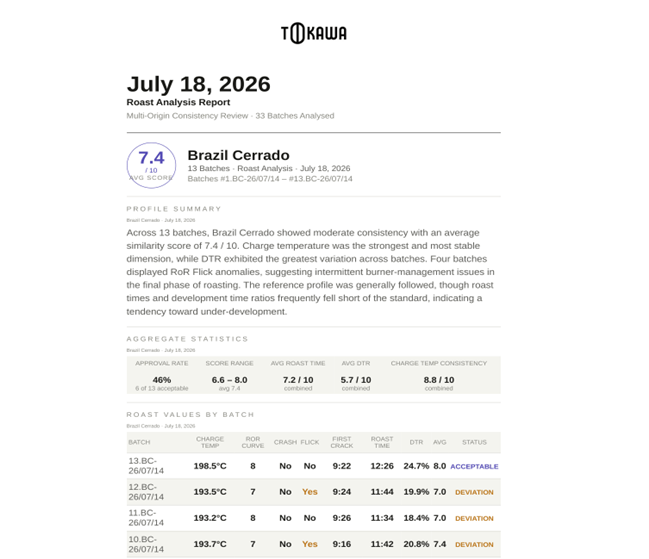

# rag-agentic-quality-control-system-tokawa-coffee-roastery

# ToKawa Coffee Quality Reporting: n8n + LLM automation for a specialty coffee roastery

Weekly roast-repeatability reports and a chat assistant over historical roast data, built with self-hosted n8n, Claude and a vector database for a specialty roastery in Szczecin, Poland (ToKawa). It runs in production on the roastery's own computer.

> This project was built as my postgraduate thesis (Warsaw School of Economics, *Knowledge acquisition from small-business data using n8n automation*). Results below come from real roast data. The company's raw data is not published.

## The problem

The roastery logs every roast in Artisan (`.alog` files), but nobody analysed them:

- Files sat in folders on one computer and were rarely reviewed. Reviewing them by hand was too tedious to yield conclusions.
- No reference profile existed per coffee, so roasters picked "a recent roast" by subjective choice.
- There was no regular feedback on repeatability, no view of quality drift over time, and a single hard-drive failure could wipe the history.

## What it does

1. **Weekly trigger** (Tuesday 08:30 CET) picks up roast-profile PDFs from Google Drive, one folder per coffee.
2. **Compares each roast with the reference profile** of that coffee. The LLM extracts charge temperature, first crack time, roast duration and DTR, then scores similarity from 0 to 10 on five dimensions (charge temp, RoR curve, first crack, roast time, DTR).
3. **Generates a styled HTML report** from a style and a structure template, converts it to PDF, emails it to the team and archives it on Drive.
4. **Indexes the report** (chunked, embedded, stored in Pinecone) so people can ask questions in a **chat interface**, for example "compare the Brazilian coffees from the last two reports".
5. **Deletes processed files** so they are not analysed twice.

## Architecture

Four n8n workflows:

| Workflow | Role |
| --- | --- |
| `Analyze PDFs` | Orchestrates the run: loads templates, loops over coffee folders, builds and sends the report, indexes it |
| `Compare PDFs` | Sub-workflow: compares one roast PDF with its reference and returns scores |
| `Delete Analysed Files` | Cleans up processed files on Drive |
| `Chat With Reports` | Always-on RAG agent with window memory over the report index |

| Component | Technology |
| --- | --- |
| Orchestration | n8n (self-hosted, Docker Compose) |
| Roast analysis, chat | Claude Sonnet 4.6 (Anthropic API) |
| Report generation | Claude Opus 4.6 (higher output-token limit for long HTML) |
| Embeddings | Cohere `embed-english-v3.0` (1024 dimensions) |
| Vector store | Pinecone |
| HTML to PDF | ConvertAPI |
| Storage, delivery | Google Drive, Gmail |

RAG settings: 1800-character chunks, 250-character overlap, cosine k-NN retrieval. The agent is instructed to answer only from the reports and to say so when it cannot find the answer.

## Results (real data, thesis period)

| Metric | Result |
| --- | --- |
| End-to-end run time | about 6-10 minutes per weekly run |
| Volume | 40-60 roast PDFs per week |
| Manual review time | about 60 min before, about 10 min after (per report) |
| Chat response time | about 5-10 seconds |
| Running cost | about 15-20 USD (about 60-80 PLN) per month |
| Reports needing no manual correction | about 95% at the time of writing |

Chat testing covered general questions, detailed questions across periods, comparisons across reports and out-of-scope questions, where the agent correctly declined to answer. Staff described the reports as helpful, clear and well designed. The ROI figure in the thesis (6-month payback) is an estimate, not a measured result.

## Known limitations

- **Fragile input path:** roasts are converted from `.alog` to PDF by hand, and the LLM reads the PDF to extract numbers. Values that code could compute exactly are left to a model.
- **RoR anomalies** (crash, flick) are taken from file names and entered by hand.
- **Vendor dependency:** ConvertAPI is on a free trial.
- **RAG consistency:** chunking may split report context, and semantic coherence can suffer.

## Roadmap (v2)

- [ ] Parse `.alog` files directly in Python (charge temperature, first crack, roast time, DTR, RoR) and score deterministically against reference profiles. The LLM only writes the commentary.
- [ ] Add pytest tests for the parser and scoring, plus logging and clear failure handling.
- [ ] Measure before and after on the same files: share of reports needing correction, failure rate, cost and time per report.
- [ ] Replace ConvertAPI with a self-hosted renderer (headless Chrome).
- [ ] Improve report chunking for retrieval.
- [ ] Detect RoR anomalies automatically.

## Running it

1. Install Docker and start n8n with Docker Compose.
2. Create credentials in n8n for Anthropic, Google Drive (OAuth2), Gmail (OAuth2), Pinecone and Cohere. Keep keys in n8n credentials or environment variables, never in this repo.
3. Import the workflow JSON files from `workflows/` and set the folder and reference-file IDs in the `Define Folders and Standards` node.
4. Upload the style and structure JSON templates to Drive and point the template nodes at them.

## Author

Maciej Pułka. Background in roasting (1.5 years) and barista work (3.5 years), AI in business (postgraduate), cognitive science (BA), Python.
